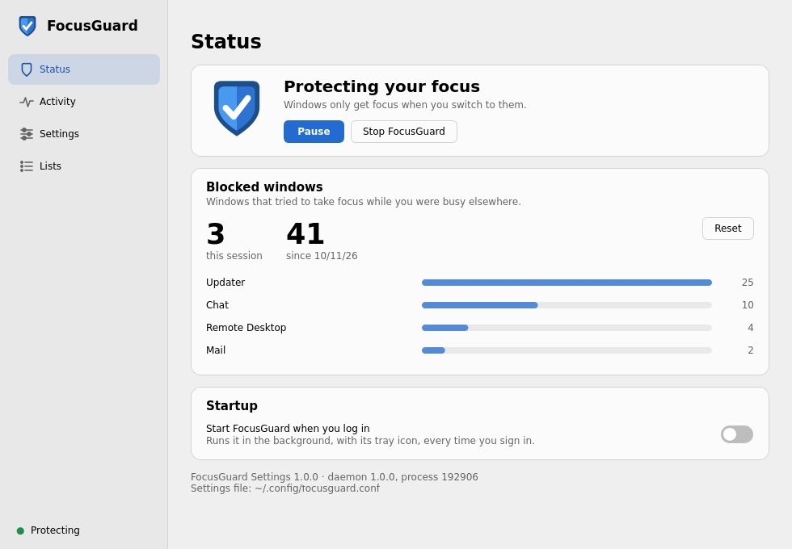
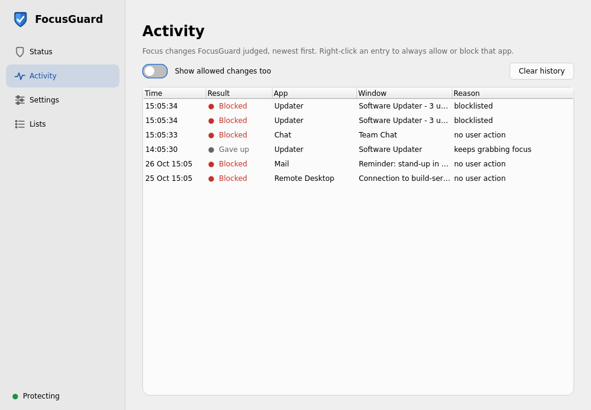
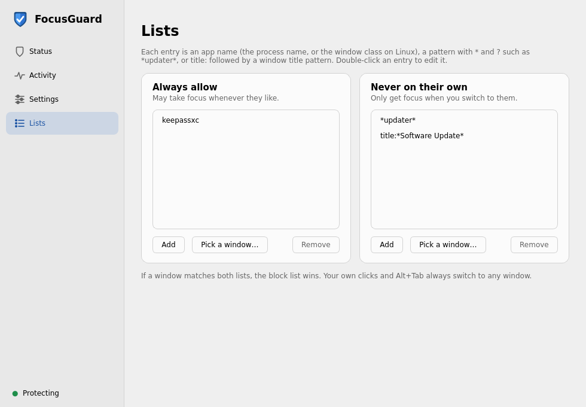
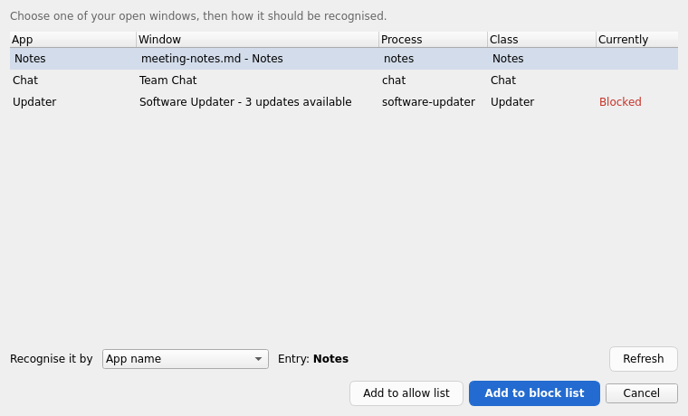
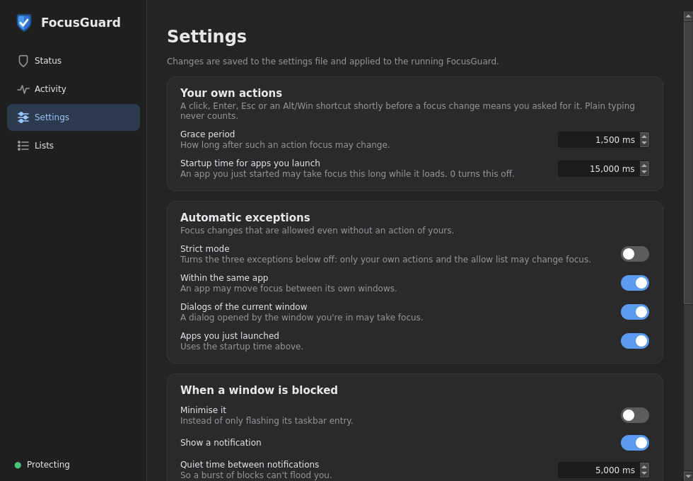

<p align="center">
  
</p>

<h1 align="center">FocusGuard</h1>

<p align="center">
  <b>Stops windows from stealing your keyboard focus, on Windows and Linux.</b>
</p>

<p align="center">
  <a href="https://github.com/DylanBeMe/FocusGuard/actions/workflows/build.yml"></a>
  <a href="https://github.com/DylanBeMe/FocusGuard/releases/latest"></a>
  <a href="LICENSE"></a>
</p>

You're typing an email, and halfway through a sentence an updater, a chat app or a "something finished" dialog jumps in front and swallows your keystrokes. FocusGuard prevents that. When a window grabs focus without you asking for it, FocusGuard hands focus straight back to the window you were using and makes the newcomer's taskbar entry flash, so you can switch to it when *you* want.

It is a tiny native background program: it sleeps until the system reports a focus change or an input event, uses no CPU while idle and a couple of MB of memory, and never sits in your keyboard or mouse input path, so it can't add latency. An optional companion app, **FocusGuard Settings**, shows what it's doing and lets you change everything without touching a config file.

<p align="center">
  
  
</p>

## Contents

- [Features](#features)
- [Install](#install)
- [How it decides](#how-it-decides)
- [The tray icon](#the-tray-icon)
- [The settings app](#the-settings-app)
- [Settings file and command line](#settings-file-and-command-line)
- [History and privacy](#history-and-privacy)
- [Building from source](#building-from-source)
- [How it works](#how-it-works)
- [Limitations](#limitations)
- [Contributing](#contributing) · [License](#license)

## Features

- **Gives focus back** to your window the instant something else takes it, and flashes the intruder's taskbar entry instead.
- **Knows what you meant to do:** clicks, Alt+Tab, Win/Super shortcuts, Enter and Esc count as your intent; plain typing deliberately doesn't. Apps you just launched may still come to the front while they start, until you switch to another window.
- **Allow and block lists** by process name, Linux window class, wildcard pattern or window title.
- **Strict mode** and per-rule switches, **dry run** for tuning, **minimise** persistent offenders, rate-limited **notifications** (on Linux with *Show it* and *Always allow* buttons).
- **Pause for a while**: 15 minutes, an hour, or until you resume.
- **Tray icon** on both platforms that shows the state at a glance (protecting, paused, dry run).
- **Settings app** with live activity (including how long after your last action each window arrived, to help tune the grace period), statistics, every option explained, list editing and a window picker.
- **History** of blocked windows and all-time statistics that survive restarts (can be turned off).
- **Live reload**: change the settings and they apply immediately.
- **Light on resources**, event-driven, no input hooks, no admin rights needed.

## Install

### Windows

Download `focusguard-<version>-windows-x64-setup.exe` from the [latest release](https://github.com/DylanBeMe/FocusGuard/releases/latest) and run it. It installs for your user account only, with no administrator prompt, adds **FocusGuard** to the Start menu, and starts FocusGuard right away and whenever you log in (you can untick that). Running a newer installer later upgrades in place and keeps your settings. Uninstall it from Windows' *Installed apps*.

**Portable:** download `focusguard-<version>-windows-x64.zip` instead and unzip it anywhere, keeping the files together. Run **`focusguard-settings.exe`**, click **Start FocusGuard**, and turn on **Start FocusGuard when you log in** if you want it running all the time.

Both contain `focusguard-tray.exe` (FocusGuard without a console window, which the installer and the settings app start), `focusguard.exe` (the same with a console that shows its log) and `focusguard-settings.exe` with the Qt files it needs. The installer and the settings app need Windows 10 or later; FocusGuard itself also runs on Windows 7 and 8 from the zip. To also protect windows of programs running as administrator, FocusGuard itself has to run as administrator.

Windows may show a SmartScreen warning the first time, because the programs aren't code-signed yet; choose *More info* → *Run anyway*.

### Linux (X11)

**Debian, Ubuntu, Mint and other Debian-based distributions** (Ubuntu 22.04 / Debian 12 or newer): download `focusguard_<version>_amd64.deb` from the [latest release](https://github.com/DylanBeMe/FocusGuard/releases/latest) and install it, which also pulls in the Qt libraries the settings app needs:

```sh
sudo apt install ./focusguard_*_amd64.deb
```

Then open **FocusGuard Settings** from your applications menu, click **Start FocusGuard**, and turn on **Start FocusGuard when you log in**.

**Other distributions:**

1. Download `focusguard-<version>-linux-x86_64.tar.gz` from the [latest release](https://github.com/DylanBeMe/FocusGuard/releases/latest) and unpack it.
2. The settings app uses your system's Qt 6.2 or newer:
   - Debian/Ubuntu: `sudo apt install libqt6widgets6 libqt6network6`
   - Fedora: `sudo dnf install qt6-qtbase`
   - Arch: `sudo pacman -S qt6-base`
3. Copy `focusguard` and `focusguard-settings` somewhere on your `PATH` (for example `~/.local/bin`). Optionally copy `focusguard-settings.desktop` to `~/.local/share/applications/` and `focusguard.svg` to `~/.local/share/icons/hicolor/scalable/apps/` for a menu entry.
4. Run `focusguard-settings`, click **Start FocusGuard**, and turn on **Start FocusGuard when you log in**.

FocusGuard itself only needs libraries every Linux desktop already has (libX11, libXi and libdbus). Or [build it from source](#building-from-source).

## How it decides

Every focus change is allowed if any of these is true; otherwise it's reverted:

1. **You did something deliberate** in the last 1.5 s: a mouse click, Enter, Esc, Alt/Win/Super, or any Alt/Win shortcut (Alt+Tab, Win+1, ...). Plain typing does *not* count, because that's exactly when a steal hurts.
2. **The previous window is gone**: closed, minimised, or on another workspace or virtual desktop.
3. **It's on your allow list.**
4. **It's the same application** (an app opening its own window), or **a dialog** of the window you were in.
5. **You just launched it**: its process started right after one of your deliberate actions and is less than 15 s old, so "Start menu → type → Enter → the app appears 5 s later" works. If you switch to another window while it's starting, that pass ends: you've moved on, and it waits in the taskbar instead.

The **block list** takes away rules 3 to 5 for matching windows: they only get focus when you switch to them yourself. Rules 4 and 5 can be switched off one by one, or all at once with **strict mode**. Simulated input (SendInput, xdotool, macro tools) never counts as you. If an app fights back more than 10 times in 3 s, FocusGuard lets it win rather than flicker forever.

## The tray icon

The shield in the tray shows the state: **blue** when protecting, **grey** when paused, **amber** in dry run. Left-click pauses and resumes. The menu has pause (also for 15 minutes or 1 hour, after which FocusGuard resumes by itself), strict mode, minimise blocked windows, notifications, dry run, statistics, **Settings…** (opens the settings app, or the settings file if the app isn't installed), reload and quit.

Toggles you make in the tray menu stay in effect when the settings are reloaded, until the settings file itself changes that setting. The settings app points them out and can save them to the file.

On Linux, FocusGuard uses whichever tray your desktop has:

- **StatusNotifierItem** trays: KDE Plasma, Xfce, Cinnamon, LXQt, Budgie, waybar, and GNOME with the *AppIndicator* extension (on by default in Ubuntu).
- **XEmbed** trays: i3bar, polybar, stalonetray, trayer and older panels. These show the icon without a menu; right-click opens the settings app instead.

If there's no tray, FocusGuard says so once and adds the icon as soon as one appears. `tray = no` turns the icon off.

With `notify = yes`, each blocked window gets a desktop notification. On Linux it has two buttons: **Show it** brings the window to the front, and **Always allow** adds its app to the allow list in your settings file. On Windows, clicking the notification shows the window.

## The settings app

`focusguard-settings` (Qt 6, Windows and Linux) has four pages:

| | |
| --- | --- |
| **Status** | Whether FocusGuard is protecting, paused or in dry run; Pause (until you resume, for 15 minutes or for an hour), Resume and Start/Stop; how many windows were blocked this session and since you started counting, with the top offenders; switches to start FocusGuard at login and to check for new versions. The first time you open it, it offers to start FocusGuard now and at every login. |
| **Activity** | Every decision as it happens: time, result (blocked, would block, gave up; optionally allowed too), app, window title, reason, and how long after your last click, Alt+Tab, Enter or similar it came. Times close to your grace period are orange; hover over one to see whether a shorter or longer grace period would have changed the outcome. Right-click an entry to always allow or block that app. |
| **Settings** | Every option, explained, with switches and fields. |
| **Lists** | The allow and block lists. **Pick a window…** shows your open windows with their app, process, class and title; choose one and how to recognise it, and the right entry is added. |

<p align="center">
  
  
</p>
<p align="center">
  
</p>

Changes are saved into the settings file the running FocusGuard reads. The app edits it in place, so your comments and layout stay, and FocusGuard applies it immediately. It follows your system's light or dark theme.

## Settings file and command line

Settings come from a file and from the command line; the command line wins. The file lives at:

- **Linux:** `~/.config/focusguard.conf` (or `$XDG_CONFIG_HOME/focusguard.conf`)
- **Windows:** `%APPDATA%\FocusGuard\focusguard.conf`

[`focusguard.conf.example`](focusguard.conf.example) documents every key. Every key also works as `--key=value` on the command line (`--strict=no`, `--tray=no`, `--history=no`, ...). `focusguard --print-config` shows the effective settings, `focusguard --help` all options:

```
Timing
  -g, --grace MS         window after a deliberate action           [1500]
  -L, --launch-grace MS  how long a freshly launched app may grab    [15000]
      --fight-limit N    give up after N reverts in 3 s (0 = never)  [10]
Lists
  -a, --allow NAME       always let NAME take focus
  -b, --block NAME       never let NAME take focus on its own
Rules
      --strict           only your actions + allow list may change focus
      --no-same-app / --no-launched / --no-related
On a block
      --minimize         also minimise the offending window
      --notify           show a desktop notification
  -n, --dry-run          only log what would be blocked
Misc
  -v/--verbose  -q/--quiet  --count-motion  --log FILE  -c/--config FILE
      --print-config  --no-tray  --background   (last one: Windows)
```

### The lists

**`allow`** lists windows that may always take focus. **`block`** lists windows that may never take focus on their own, not even right after you launch them; your own clicks and Alt+Tab still switch to them. Each entry is one of:

- a **name**: the process name (`keepassxc`, `obs64.exe`, where `.exe` is optional), or on Linux the window's class (find it with `xprop WM_CLASS`, or use the settings app's window picker);
- a **pattern** with `*` and `?` (`*updater*`), matched against the process name, the class and the window title;
- a **title pattern** (`title:Save As`, `title:*Software Update*`), matched against the window title only.

Lists are repeatable and comma-separated (`block = *updater*, teams`). If a window matches both lists, the block list wins. `focusguard --dry-run --verbose` logs every focus change with its process, class, title and the reason it was allowed or blocked, which helps find the right names.

### Control without the tray

| Action | Windows | Linux |
| --- | --- | --- |
| Pause / resume | settings app, or left-click the tray icon | settings app, tray, or `pkill -USR1 focusguard` |
| Pause for a while | settings app, or the tray menu | settings app, or the tray menu |
| Show statistics | settings app, or the tray menu | settings app, tray, or `pkill -USR2 focusguard` |
| Reload settings | automatic from the settings app, or the tray menu | automatic from the settings app, tray, or `pkill -HUP focusguard` |
| Quit | settings app, tray menu, or Ctrl+C | settings app, tray, Ctrl+C, or `pkill focusguard` |

## History and privacy

FocusGuard keeps a short history of the windows it blocked (time, app, window title and reason, up to the last 300 entries) and a count of blocks per app, so the settings app can show them after a restart. Everyday focus changes that are allowed are kept in memory only. FocusGuard itself never sends anything anywhere.

The settings app can check for new versions, but only if you turn on **Check for new versions** on its Status page. It then asks GitHub's public API for the latest FocusGuard release at most once a day; GitHub sees your IP address and the app's version, and nothing else is sent.

- **Linux:** `~/.local/state/focusguard/` (or `$XDG_STATE_HOME/focusguard/`)
- **Windows:** `%LOCALAPPDATA%\FocusGuard\`

**Clear history** on the Activity page and **Reset** on the Status page empty them; `history = no` stops keeping them at all. The control channel the settings app uses is a Unix socket in `$XDG_RUNTIME_DIR` on Linux and a named pipe on Windows, both accessible to your user account only.

## Building from source

Requirements: CMake 3.16+, a C++17 compiler, and Qt 6.2+ (Widgets and Network) for the settings app.

**Linux:**

```sh
sudo apt install g++ cmake pkg-config libx11-dev libxi-dev libdbus-1-dev qt6-base-dev
# Fedora: libX11-devel libXi-devel dbus-devel qt6-qtbase-devel   Arch: libx11 libxi dbus qt6-base
cmake -B build && cmake --build build
ctest --test-dir build          # unit tests
sudo cmake --install build      # both programs, a menu entry and the icon
(cd build && cpack -G DEB)      # or a .deb package (configure with -DCMAKE_INSTALL_PREFIX=/usr)
```

**Windows** (Visual Studio 2022 or MinGW-w64, with Qt for the settings app):

```bat
cmake -B build -DCMAKE_PREFIX_PATH=C:\Qt\6.8.3\msvc2022_64
cmake --build build --config Release
ctest --test-dir build -C Release
C:\Qt\6.8.3\msvc2022_64\bin\windeployqt build\Release\focusguard-settings.exe
```

| CMake option | Default | |
| --- | --- | --- |
| `FOCUSGUARD_GUI` | `ON` | Build the settings app (skipped with a warning if Qt 6 isn't found). |
| `FOCUSGUARD_TRAY` | `ON` | Linux: StatusNotifierItem tray icon and D-Bus notifications (needs libdbus). Without it the XEmbed tray icon still works. |
| `FOCUSGUARD_NO_CONSOLE` | `OFF` | Windows: build FocusGuard without a console window (the release's `focusguard-tray.exe`). |
| `FOCUSGUARD_TESTS` | `ON` | Build the unit tests. |

FocusGuard itself also builds with a single compiler command, without CMake:

```sh
g++ -O2 -std=c++17 -DFOCUSGUARD_TRAY src/focusguard_x11.cpp $(pkg-config --cflags --libs dbus-1) -lX11 -lXi -o focusguard
g++ -O2 -std=c++17 -static src/focusguard_win.cpp -luser32 -lshell32 -ldwmapi -ladvapi32 -o focusguard.exe
```

The [GitHub Actions workflow](.github/workflows/build.yml) builds and tests everything for both platforms on every push, including installing and removing the `.deb` and the Windows installer. It publishes a release when a tag `vX.Y.Z` matching the version in `CMakeLists.txt` is pushed. To build the Windows installer yourself, install [Inno Setup 6](https://jrsoftware.org/isinfo.php) and see the command at the top of [`installer/focusguard.iss`](installer/focusguard.iss).

## How it works

- **Windows:** foreground changes arrive through an out-of-context WinEvent hook and your input through Raw Input, so FocusGuard never injects code into other programs or hooks the input path. It restores focus with the documented foreground-permission mechanisms.
- **Linux:** active-window changes come from the window manager's `_NET_ACTIVE_WINDOW` (EWMH), input from XInput 2 raw events, and focus is restored by asking the window manager, the way a taskbar does.
- **Settings app:** a separate Qt program that talks to FocusGuard over a small line-based JSON protocol ([`src/control.hpp`](src/control.hpp)) and edits the settings file. FocusGuard never depends on it.

| Path | |
| --- | --- |
| `src/common.hpp` | Shared core: settings, matching, the decision rules, statistics |
| `src/control.hpp` | Control protocol, activity log and on-disk history |
| `src/focusguard_win.cpp`, `src/focusguard_x11.cpp` | The Windows and Linux programs |
| `src/tray_sni.hpp`, `src/tray_xembed.hpp`, `src/icon.hpp` | Linux tray icons and the shield icon renderer |
| `src/ipc_win.hpp`, `src/ipc_unix.hpp` | Control channel servers (named pipe, Unix socket) |
| `gui/` | The settings app |
| `tests/` | Unit tests |
| `data/`, `tools/` | Icons, desktop entry, and the tool that generates the Windows icons |
| `installer/` | The Windows installer (Inno Setup); the `.deb` comes from CPack settings in `CMakeLists.txt` |

## Limitations

- **Wayland:** FocusGuard only sees XWayland windows there. Wayland compositors already limit focus stealing themselves (xdg-activation).
- **Linux needs an EWMH window manager**, which every mainstream one is (KWin, Mutter, Xfwm, Openbox, i3, ...).
- **Plain GNOME** shows no tray icon without the AppIndicator extension; FocusGuard works the same without it, and the settings app covers everything the tray does.
- A keystroke typed in the few milliseconds between a steal and the revert can still land in the other window; it's rare in practice.
- On Windows, FocusGuard can't hand focus back to a program running as administrator unless FocusGuard runs as administrator too.

## Contributing

Bug reports, ideas and pull requests are welcome; see [CONTRIBUTING.md](CONTRIBUTING.md). Planned work, including Wayland support, is in [next-additions.md](next-additions.md). When reporting a window FocusGuard handles wrongly, the output of `focusguard --dry-run --verbose` for that moment helps a lot.

## License

FocusGuard is free software: you can redistribute it and/or modify it under the terms of the [GNU Affero General Public License](LICENSE) as published by the Free Software Foundation, either version 3 of the License, or (at your option) any later version. It is distributed in the hope that it will be useful, but without any warranty; see the license for details.

The Windows release bundles Qt, which is licensed under the LGPL v3; see [THIRD-PARTY-NOTICES.md](THIRD-PARTY-NOTICES.md).
